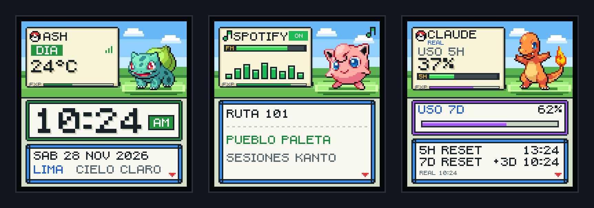
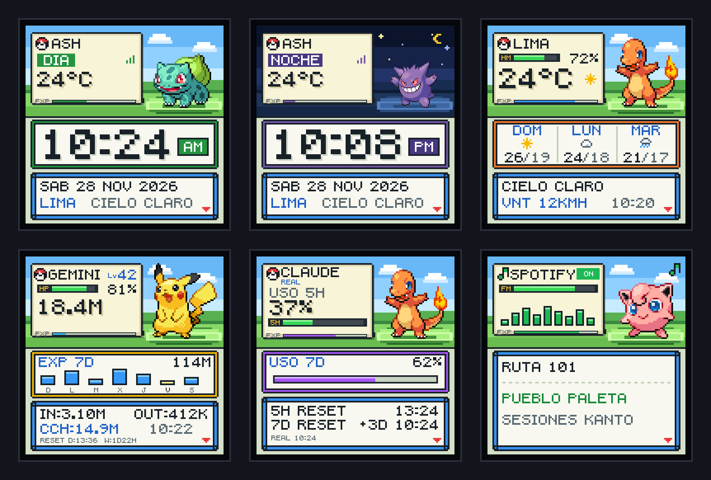
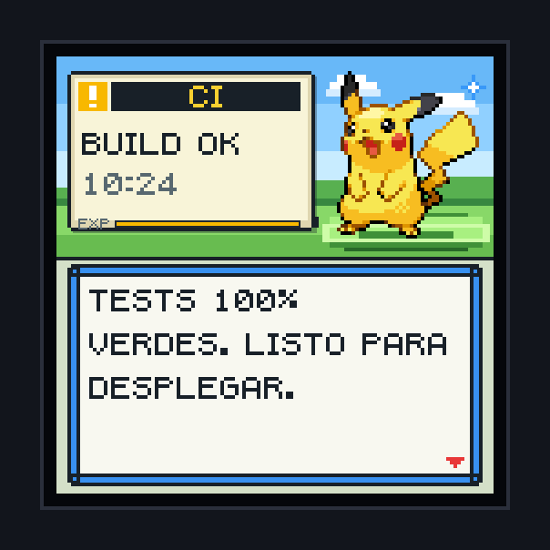
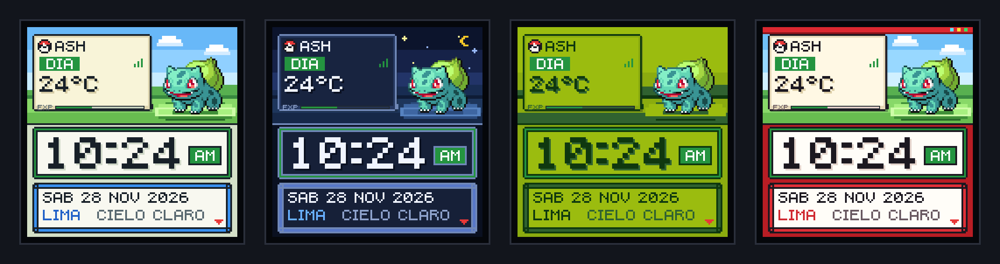
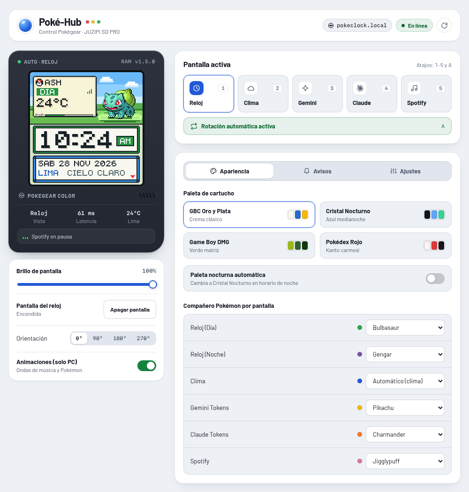
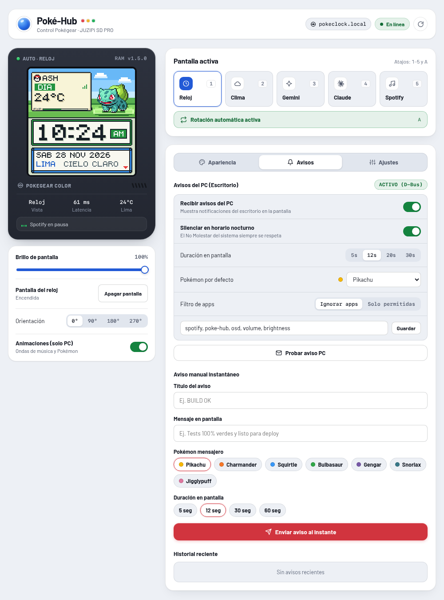
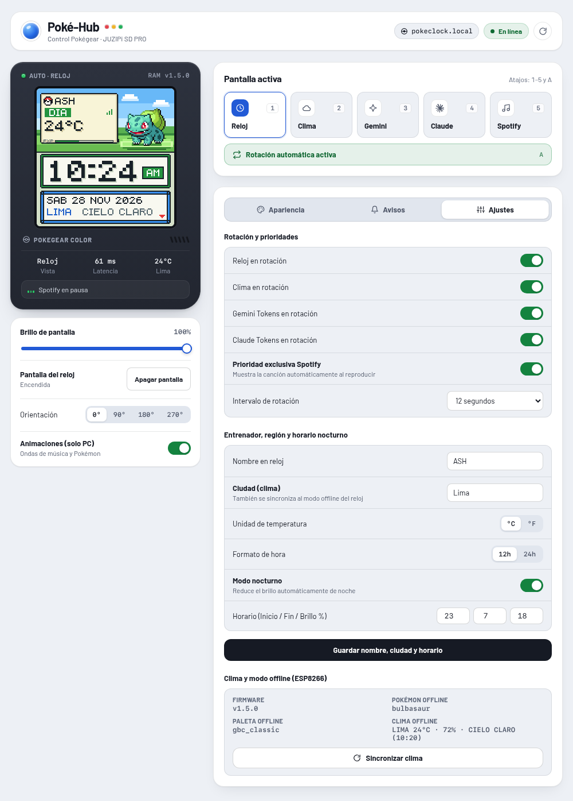
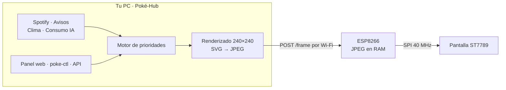

<div align="center">

# Poké-Hub

### El escritorio, convertido en una pieza de colección.

Una pantalla de 240 × 240 que reúne la hora, el clima, tu música, tus avisos y el consumo de tus asistentes de IA,
con la estética de una consola portátil clásica.

**JUZIPi SD PRO · ESP8266 · ST7789 · Control local desde tu PC**



[La experiencia](#la-experiencia) · [Pantallas](#las-pantallas) · [Centro de mando](#el-centro-de-mando) · [Cómo funciona](#cómo-funciona) · [Puesta en marcha](#puesta-en-marcha) · [Especificaciones](#especificaciones)

</div>

---

## La experiencia

Poké-Hub no es un reloj con temas. Es un sistema completo en el que **tu PC piensa y la pantalla se limita a brillar**: cada escena se compone en el computador, con sprites animados, escenarios de batalla y cajas de diálogo de píxel nítido, y viaja por tu Wi-Fi directamente a la memoria del dispositivo.

| | |
|---|---|
| **Siempre lo relevante** | Un aviso interrumpe, tu música toma el escenario y, cuando todo está en calma, las vistas rotan solas. |
| **Respuesta inmediata** | Los cambios de Spotify se detectan en tiempo real por D-Bus. |
| **Cuidado del hardware** | Los fotogramas se pintan desde la RAM, sin desgastar la memoria flash. |
| **Autonomía** | Si el PC se ausenta, la pantalla continúa con reloj y clima por su cuenta. |
| **Privacidad local** | El control, el renderizado y la lectura de consumo ocurren en tu equipo. Solo el clima consulta un servicio externo (OpenWeatherMap). |

## Las pantallas



<sub>Capturas generadas por el motor de renderizado real, con datos de demostración.</sub>

| Pantalla | Qué ofrece |
|---|---|
| **Reloj** | Hora grande en 12 o 24 h, fecha, temperatura y tu nombre de entrenador. De 19:00 a 06:00 cambia a escena nocturna con su propio compañero. |
| **Clima** | Temperatura, humedad, viento, estado del cielo y pronóstico de tres días. El escenario y el Pokémon acompañan al tiempo. |
| **Gemini** | Tokens del día y de los últimos siete días, entrada, salida y caché, a partir de los registros locales de Antigravity. |
| **Claude** | Porcentaje oficial de uso de las ventanas de 5 horas y 7 días de Claude Code, con la hora de cada reinicio. |
| **Spotify** | Canción, artista y álbum con ecualizador animado. Aparece sola al reproducir. |
| **Aviso** | Un encuentro salvaje para tus notificaciones del escritorio o tus propios mensajes. |

### Avisos que merece la pena mirar



- Recibe las notificaciones de tu escritorio y respeta el modo **No molestar**.
- Filtra por aplicación: ignora las ruidosas o admite solo las elegidas.
- Silencio opcional en horario nocturno.
- Cola ordenada: ningún aviso pisa al anterior.
- También desde la terminal, ideal para saber que una compilación terminó:

```bash
poke-ctl notify "BUILD OK" "Tests 100% verdes" --pokemon pikachu --ttl 12
```

<br clear="right">

### Cuatro acabados



<div align="center">

**GBC Oro y Plata** · **Cristal Nocturno** · **Game Boy DMG** · **Pokédex Rojo**

</div>

Elige además un compañero para cada vista: Pikachu, Charmander, Squirtle, Bulbasaur, Gengar, Snorlax o Jigglypuff.

## El centro de mando

Un panel web propio, pensado para el computador y el teléfono, con vista en vivo de lo que muestra la pantalla.



Desde aquí fijas una vista o vuelves a la rotación, ajustas brillo y orientación, apagas la pantalla y personalizas paleta y compañeros. Los atajos `1`–`5` y `A` cambian de vista sin tocar el ratón.

<table>
<tr>
<th width="50%">Avisos</th>
<th width="50%">Ajustes</th>
</tr>
<tr>
<td valign="top"></td>
<td valign="top"></td>
</tr>
</table>

Abre **`http://localhost:8765`** en tu PC o **`http://pokeclock.local:8765`** desde cualquier equipo de la misma red.

## Cómo funciona



### Un orden claro de prioridades

1. **Aviso** activo.
2. **Vista fijada** por ti.
3. **Spotify**, mientras suena (se puede desactivar).
4. **Rotación** automática entre las vistas habilitadas, cada 12 segundos por defecto.

### Continuidad

- **Descubrimiento automático:** si la IP de la pantalla cambia, Poké-Hub la vuelve a localizar por mDNS (`poke-display.local`).
- **Modo autónomo:** tras 90 segundos sin recibir imágenes (12 al arrancar), el dispositivo muestra su propio reloj y actualiza el clima cada 15 minutos.
- **Despertar y descanso:** la pantalla se enciende al iniciar el servicio y, con firmware 1.5.0 o posterior, se apaga cuando este se detiene de forma ordenada (por ejemplo, al apagar el PC). Un corte de energía no permite enviar esa orden. El Wi-Fi del reloj sigue activo.
- **Noche a tu medida:** en el horario que elijas puede reducir el brillo (modo nocturno) y cambiar a Cristal Nocturno (paleta automática). Son dos opciones independientes.

## Puesta en marcha

### Requisitos

- Pantalla **JUZIPi SD PRO** en la misma red Wi-Fi que tu PC.
- Linux con `systemd` y D-Bus.
- Python 3 con **pycairo**, **PyGObject** y **librsvg**; **libjpeg-turbo** recomendado. Como alternativa de renderizado: `rsvg-convert` e ImageMagick.
- **Avahi** para los nombres `.local`.
- Una clave de [OpenWeatherMap](https://openweathermap.org/api) para el clima.
- [PlatformIO](https://platformio.org/) para compilar el firmware.

### 1. Firmware

> [!WARNING]
> Reemplazar el firmware de fábrica es bajo tu responsabilidad. Consigue y guarda antes un respaldo del original; este repositorio no lo incluye.

```bash
git clone https://github.com/naudyweb/poke-clock.git
cd poke-clock
cp firmware/src/secrets.h.example firmware/src/secrets.h   # Wi-Fi y clima
pio run -d firmware
```

El binario queda en `firmware/.pio/build/sdpro/firmware.bin`. Contiene tus credenciales de Wi-Fi: no lo compartas.

Una vez instalado PokeDisplay, las siguientes actualizaciones se suben desde **`http://<IP-de-la-pantalla>/ota`**. Si el reloj no logra conectarse al Wi-Fi en 25 segundos, crea la red de recuperación **`PokeDisplay-OTA`** (`http://192.168.4.1/ota`).

### 2. Controlador

```bash
python3 hub/server.py
```

La configuración vive en `~/.config/poke-hub/config.json`. Define ahí `host` (IP de la pantalla), `city` y `weatherkey`, o entrega la clave con la variable `OPENWEATHER_API_KEY`.

### 3. Servicio automático

Crea `~/.config/systemd/user/poke-clock.service` ajustando la ruta:

```ini
[Unit]
Description=Poké-Hub
After=network-online.target graphical-session.target

[Service]
ExecStart=/usr/bin/python3 /ruta/a/poke-clock/hub/server.py
Restart=always
RestartSec=3

[Install]
WantedBy=default.target
```

```bash
systemctl --user daemon-reload
systemctl --user enable --now poke-clock.service
journalctl --user -u poke-clock.service -f      # registros en vivo
```

### 4. Dirección corta (opcional)

Para usar `http://pokeclock.local` sin número de puerto. El script modifica la configuración del sistema; revísalo antes de ejecutarlo.

```bash
sudo ./scripts/setup-domain.sh
sudo ./scripts/setup-domain.sh --uninstall      # revertir
```

### 5. Cuota real de Claude Code (opcional)

En `~/.claude/settings.json`:

```json
{
  "statusLine": {
    "type": "command",
    "command": "python3 /ruta/a/poke-clock/scripts/claude_usage_statusline.py"
  }
}
```

Se guardan únicamente los porcentajes, sus horas de reinicio y la hora de actualización en `~/.cache/poke-hub/claude-rate-limits.json`, con permisos privados; no se copian conversaciones ni credenciales. Los conteos de tokens de las sesiones no se usan como cuota. Si no hay datos o tienen más de 24 horas, la tarjeta indica **sin datos reales** en lugar de estimar.

## Control desde la terminal

Instala el atajo una vez: `ln -s "$PWD/poke_ctl.py" ~/.local/bin/poke-ctl`

```bash
poke-ctl status
poke-ctl show clock                  # clock · weather · gemini · claude · spotify
poke-ctl auto                        # volver a la rotación
poke-ctl refresh                     # actualizar los datos
poke-ctl brightness 85
poke-ctl display off                 # on · off
poke-ctl rotation 2                  # 0 · 1 · 2 · 3
poke-ctl palette gbc_dark            # gbc_classic · gbc_dark · gb_green · pokedex_red
poke-ctl sprite spotify snorlax
poke-ctl toggle weather off
poke-ctl toggle spotify_priority on
```

## API REST

| Método | Ruta | Función |
|---|---|---|
| `GET` | `/api/status` | Estado del sistema, configuración y dispositivo |
| `GET` | `/api/preview/<vista>` | Imagen JPEG de una vista (o `active`) |
| `POST` | `/api/show` | Fijar una vista: `{"card": "clock"}` |
| `POST` | `/api/auto` | Volver a la rotación |
| `POST` | `/api/notify` | Enviar un aviso |
| `POST` | `/api/notify/test-desktop` | Probar un aviso de escritorio |
| `POST` | `/api/config` | Cambiar la configuración |
| `POST` | `/api/brightness` | Brillo: `{"val": 85}` |
| `POST` | `/api/display` | Encender o apagar: `{"on": false}` |
| `POST` | `/api/rotation` | Orientación: `{"val": 2}` |
| `POST` | `/api/refresh` | Actualizar los datos |

> [!IMPORTANT]
> La API **no pide autenticación** y por defecto escucha en toda la red local; `/api/status` incluye la configuración, clave del clima incluida. Úsala solo en una red de confianza y no la expongas a Internet. Para limitarla a tu PC, inicia el servidor con `--bind 127.0.0.1`.

## Especificaciones

| Elemento | Detalle |
|---|---|
| Panel | ST7789, 240 × 240 |
| Microcontrolador | ESP8266 a 160 MHz |
| Bus de imagen | SPI a 40 MHz |
| Transferencia | JPEG completo o parcial, por Wi-Fi, directo a RAM |
| Firmware | PokeDisplay RAM 1.5.0 |
| Controlador | Python, ejecutándose en tu PC |
| Interfaces | Panel web, CLI `poke-ctl`, API REST |
| Idioma | Español |

---

<div align="center">
<sub>Proyecto personal hecho por afición, sin afiliación ni respaldo de Nintendo, Game Freak, The Pokémon Company, Spotify, Google o Anthropic.<br>Pokémon y las demás marcas pertenecen a sus respectivos titulares.</sub>
</div>
